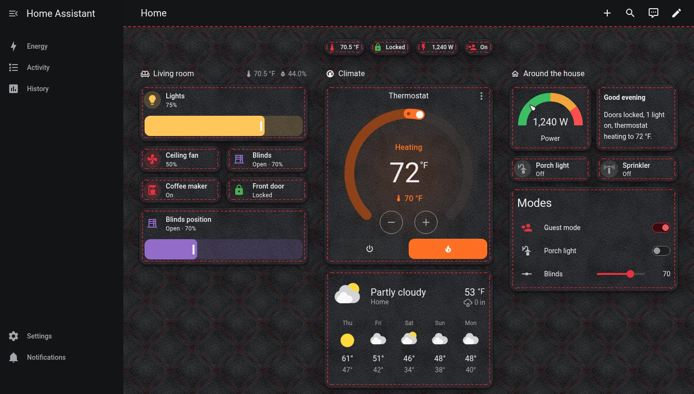
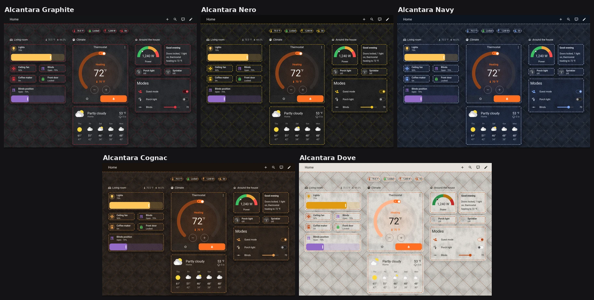
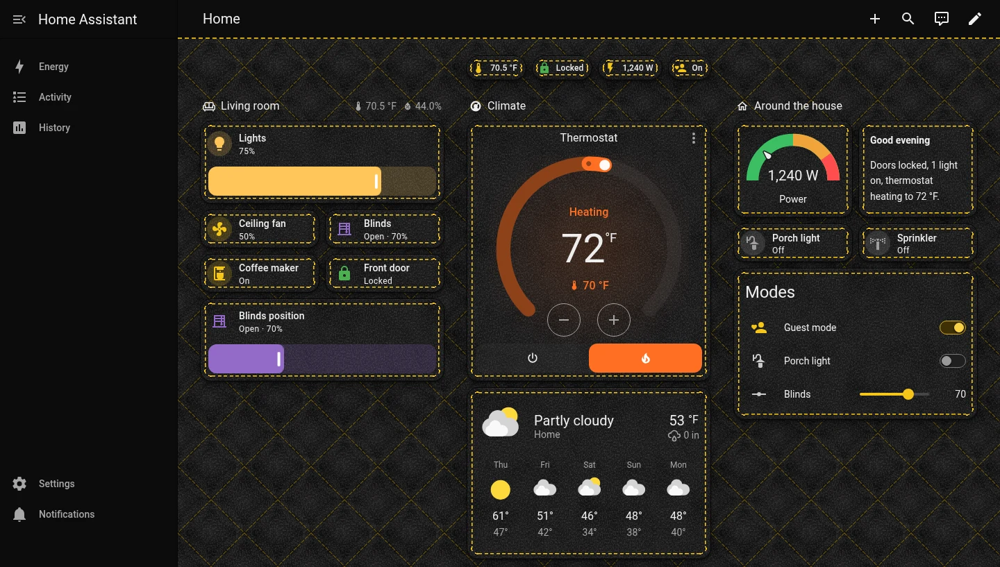
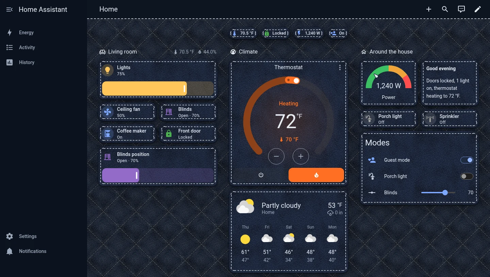
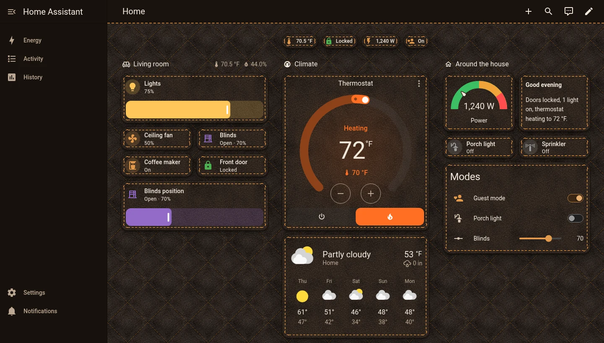
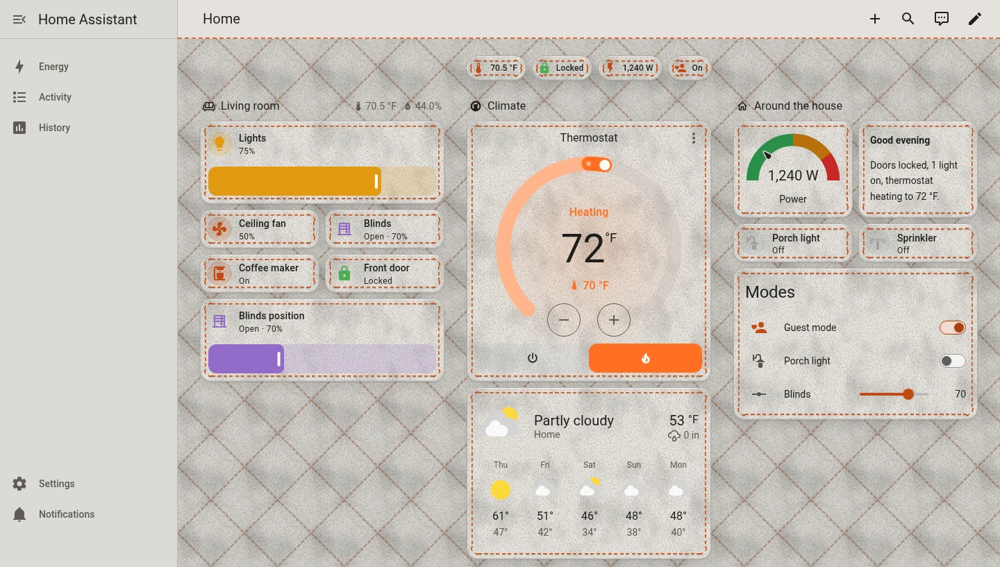

# Alcantara

[](https://hacs.xyz/docs/faq/custom_repositories/)
[](https://github.com/edwork/alcantara-theme/actions/workflows/validate.yml)
[](https://my.home-assistant.io/redirect/hacs_repository/?owner=edwork&repository=alcantara-theme&category=theme)

Suede-and-stitching Home Assistant themes: a quilted Alcantara-style page, cards with a stitched seam, and a
stitched header. There are five colourways, plus one that follows light and dark mode.





<details>
<summary>Each colourway at full size</summary>






</details>

## Themes

| Theme | Mode | Stitching |
|---|---|---|
| **Alcantara** | light + dark | Dove in light mode, Graphite in dark mode |
| **Alcantara Graphite** | dark | red |
| **Alcantara Nero** | dark | yellow |
| **Alcantara Navy** | dark | silver |
| **Alcantara Cognac** | dark | tan |
| **Alcantara Dove** | light | orange |

The single-mode themes switch Home Assistant into that mode while they're selected.

## Design

- **Page:** a quilted diamond pattern with a soft puff in each diamond and dashed thread along the seams, over a
  directional suede grain.
- **Cards:** the same grain, plus a stitched seam about 6 px inside the edge with dashed corners and a pressed
  shadow under the thread.
- **Header:** a dashed thread line along the bottom.
- The primary colour and the `ha-color-primary-*` scale follow each colourway, so switches, sliders and newer
  buttons match the thread.

The stitching is built from layered CSS gradients in `--ha-card-background`, so no card-mod is needed. The grain and
quilt textures are SVGs embedded in the theme file, so there's nothing to copy into `www/`.

## Installation

### HACS

1. HACS → ⋮ → **Custom repositories**. Add `https://github.com/edwork/alcantara-theme` with type **Theme**.
2. Search for **Alcantara**, then **Download**.
3. Run the **Home Assistant Frontend: Reload themes** action (`frontend.reload_themes`), or restart.

### Manual

Copy [`themes/alcantara.yaml`](themes/alcantara.yaml) into your `config/themes/` folder, then reload themes.

Either way, your `configuration.yaml` needs to load themes from that folder:

```yaml
frontend:
  themes: !include_dir_merge_named themes
```

## Usage

- **Your profile:** your user (bottom left) → **Theme** → any of the six.
- **One view:** edit the view → **Theme**, or `theme: Alcantara Cognac` in YAML. A view theme styles the view's
  content; the header and sidebar keep your profile theme.

## Customising

`themes/alcantara.yaml` is generated, so don't edit it by hand. The colourways are a table at the top of
[`tools/build_theme.py`](tools/build_theme.py) (page, card, seam, stitch, primary and text colours). Add or change
one and run:

```sh
python3 tools/build_theme.py            # regenerate themes/alcantara.yaml
python3 tools/build_theme.py --check    # what CI runs: fails if the YAML is out of date
```

The stitch geometry (inset, corner radius, thread width, dash and gap) is a set of constants in the same file. It
needs only Python 3.9+ and the standard library.

## Credits

Alcantara® is a registered trademark of Alcantara S.p.A. This theme only imitates the look of the material, and
the project isn't affiliated with or endorsed by Alcantara S.p.A.

## License

[MIT](LICENSE)
